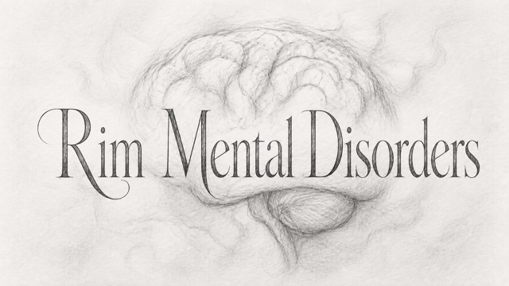

<p align="center">
  
</p>

<p align="center">
  <a href="README_CN.md">Chinese version</a>
</p>

# Rim Mental Disorders

## Design goals

The mod separates mental disorders into five layers: disease definitions, cause records, acquisition rules, symptom mechanics, and external compatibility. Its central design is that disorders emerge from pawn experiences while the trauma and acquisition infrastructure remains reusable by other mods.

Comorbidity is currently disabled. A pawn may have at most one disorder from this mod, preventing multiple behavior-altering conditions from competing for control of mental breaks, work, and combat.

## System architecture

### Disease layer

Disorders are defined as `HediffDef` records. Runtime behavior is implemented by `Hediff_MentalDisorder` and its mechanic extensions. Four severity tiers—mild, moderate, severe, and extreme—determine baseline social prejudice. By default, only extreme disorders grant a minimum psylink level of 6; mild, moderate, and severe disorders grant none. The **Psylink grants** settings page offers an independent enable switch and minimum level (1–6) for each severity. Disabling or lowering a grant preserves existing psylinks; condition-specific abilities remain part of their respective disorders. Older settings without these per-severity options adopt the new extreme-only defaults.

Stat modifiers, mood memories, and behavior mechanics are kept separate. XML contains static data, while C# handles stateful behavior, target selection, and event reactions.

### Etiology and trauma layer

`MentalCauseDef` describes an accumulative and optionally recoverable cause. A hidden `Hediff_MentalEtiology` on each pawn stores amount, event count, source, timing, and recovery progress.

High-frequency events do not accumulate once per hit without limits. Combat, brain injury, long-range gunfire, and psychic attacks use incident windows and per-incident caps. Relationship rupture is keyed by the other pawn, so conflict with the same person during one in-game hour is one event.

Sustained high mood gradually establishes stability and removes recoverable trauma. Causes such as age or irreversible brain damage may opt out of high-mood recovery.

### Disease acquisition layer

`DiseaseAcquisitionExtension` connects disorders to etiological conditions. An acquisition recipe can express:

- conditions that must all be met;
- conditions where any one is sufficient;
- alternative groups of paths;
- cause amount, event count, and temporal ordering;
- acquisition chance and cooldown.

The initial disorder chance, severity weights, and per-disorder weights within each severity are configurable. Acquired disorders use the same severity and disease weighting model.

### Presentation and UI layer

The pawn inspection panel contains a Trauma tab with separate Trauma Records and Possible Disorders pages. Records are grouped by cause and source. Risk entries expose acquisition progress and can be filtered by severity.

Tooltips provide a short clinical summary. The health details page provides structured effects, dynamic state, and etiology. Internal framework terminology is not exposed in player-facing text.

### Compatibility layer

RimTalk compatibility calls its public context-injection API through reflection and creates no hard assembly dependency. When RimTalk is active, disorders, current phases, dynamic targets, and social prejudice enter dialogue context. Without RimTalk, the compatibility layer remains inactive.

Anomaly is a required dependency. The mod directly reuses its psychic slaughter ability and also integrates with mind-numb serum.

## Extension API

Other mods can define trauma types using `TraumaDef`, the public alias of `MentalCauseDef`, and attach `DiseaseAcquisitionExtension` to any `HediffDef`.

`TraumaAPI` exposes:

- `Add`
- `Reduce`
- `GetSeverity`
- `GetRecords`
- `GetDiseaseRisks`
- trauma change and recovery events

An extension can add causes and acquisition recipes using XML alone. It only needs the API when gameplay code must actively record trauma.

## Data flow

```text
Game event or long-term state
        ↓
Cause sampling and incident deduplication
        ↓
Hediff_MentalEtiology
        ↓
DiseaseAcquisitionExtension evaluation
        ↓
Severity weight → disorder weight
        ↓
Hediff_MentalDisorder
        ↓
Stats, mood, behavior, episodes, and compatibility context
```

## Repository layout

```text
1.6/Defs/                         XML definitions
1.6/Languages/                    localization
1.6/Patches/                      XML patches and acquisition recipes
1.6/Assemblies/                   loadable assembly
Source/MoreMentalDisorders/       C# source
About/                            metadata and preview
work/                             validation helpers
```

The runtime target is RimWorld 1.6 with Harmony, Royalty, and Anomaly.

## September feedback fixes

Newborns and babies are excluded from disorder generation and trauma tracking. Existing infant disorder and etiology hediffs are removed on their next health tick. Only states registered by a `MentalBreakDef` (plus this mod's panic episode) are intercepted or recorded as mental-break trauma; crying, giggling, and other ordinary states keep their vanilla behavior.

The insomnia task patch now checks its sampling interval before querying disorders and uses Harmony field injection instead of per-tick reflection. Common disorder lookups no longer allocate and sort temporary lists.

Trauma labels default to English, with Chinese translations, and custom-def translation folders use the fully qualified type name. Saved fear triggers resolve their labels in the active language instead of reusing the language saved at creation.

These changes do not remove already-earned psylinks or retroactively diagnose adult pawns' old trauma records. In-game crib/bed performance still needs confirmation with the reporting player's mod list.
